<p align="center">
  <picture>
    <source media="(prefers-reduced-motion: reduce)" srcset="./assets/readme/hero.png">
    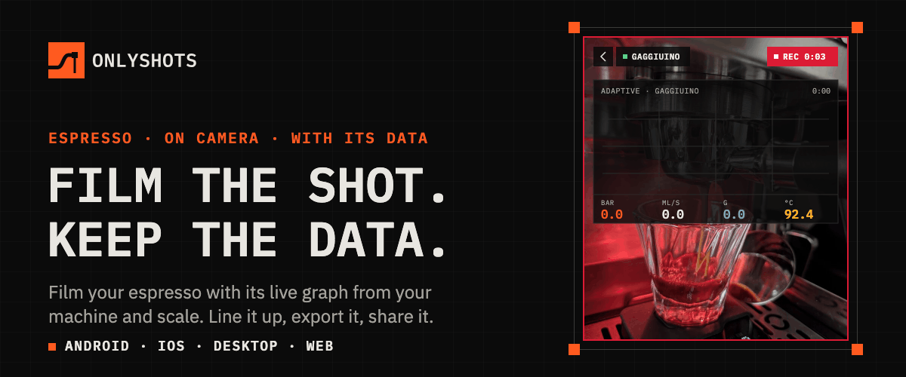
  </picture>
</p>

<p align="center">
  <a href="https://onlyshots.vercel.app"><strong>Try the editor in your browser →</strong></a>
  &nbsp;·&nbsp;
  <a href="https://github.com/parez-dev/OnlyShots/releases">Desktop (macOS, Windows, Linux)</a>
  &nbsp;·&nbsp;
  Android and iOS: coming soon
</p>

OnlyShots films your espresso shot with its graph on top, drawn live from your machine and scale. Pick what the graph
shows (pressure, flow, weight, temperature, phases, shot time), put it where you want it, and export a video that's ready
to share. Filmed already? Bring any video and a shot file, and OnlyShots lines them up for you.

<p align="center">
  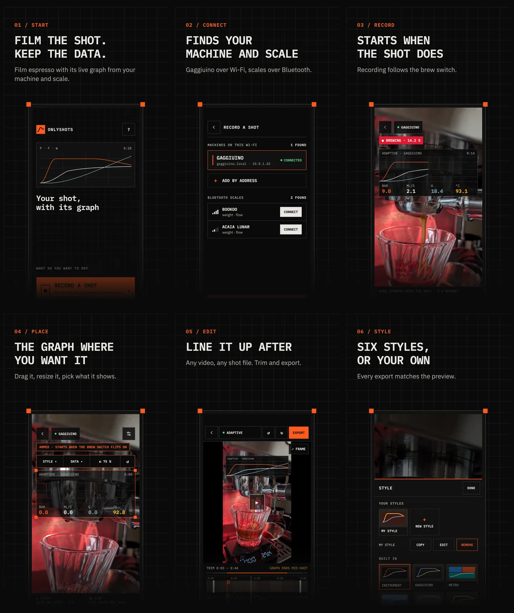
</p>

<p align="center">
  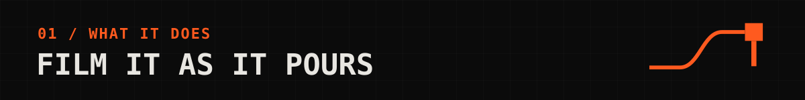
</p>

### Record a shot

- Connects to a Gaggiuino-modded machine over your Wi-Fi, or to a Bluetooth scale.
- Starts recording when the brew switch flips on and stops a few seconds after the shot, so your hands stay free.
- Keeps a few seconds from before the shot, so the first drops are on film.
- No machine? Use a scale on its own, or try the built-in sample shot.

<p align="center">
  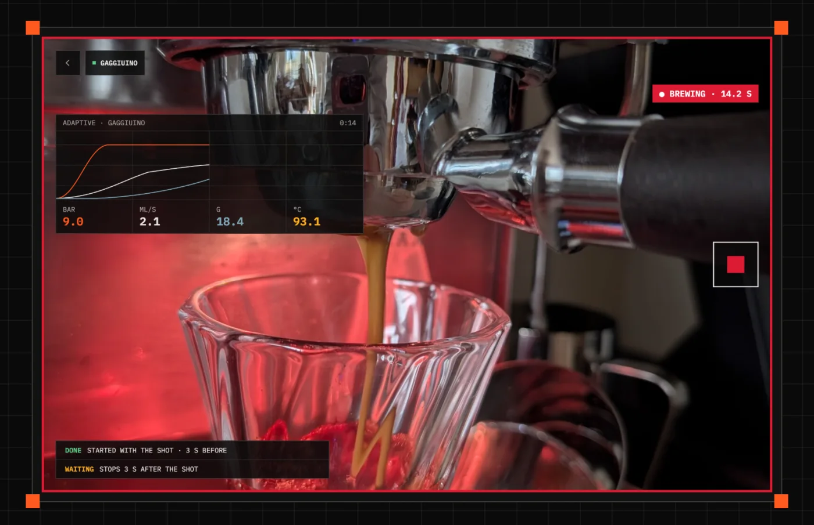
</p>

### Put the graph where you want it

- Drag and resize the graph on the camera view, and pick what it shows.
- Choose a built-in style or make your own: colours, lines, grid, readings, text, glass and blur.
- What you see in the preview is exactly what the export draws.

<p align="center">
  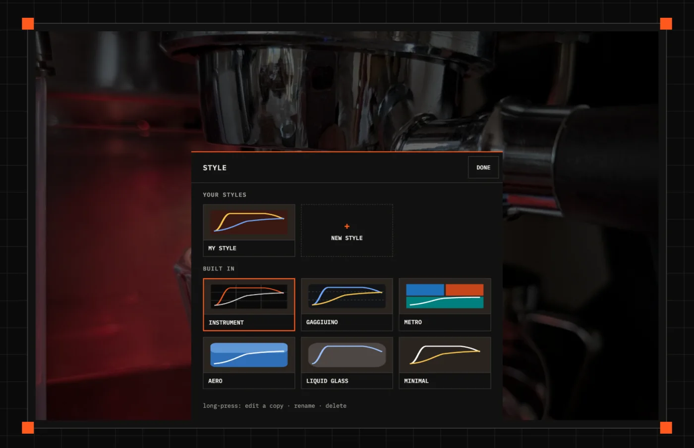
</p>

### Edit after

- Pick any video and a shot file, and line them up by the video's clock, by the pump's sound, or by hand.
- Trim, frame it in 9:16, 4:5, 1:1 or 16:9, and move the crop. Undo and redo every change.
- Import shots from your Gaggiuino's history, from `.shot` files, or from [Visualizer](https://visualizer.coffee) by
  share code or link: any machine's shot there, or a Beanconqueror brew.

<p align="center">
  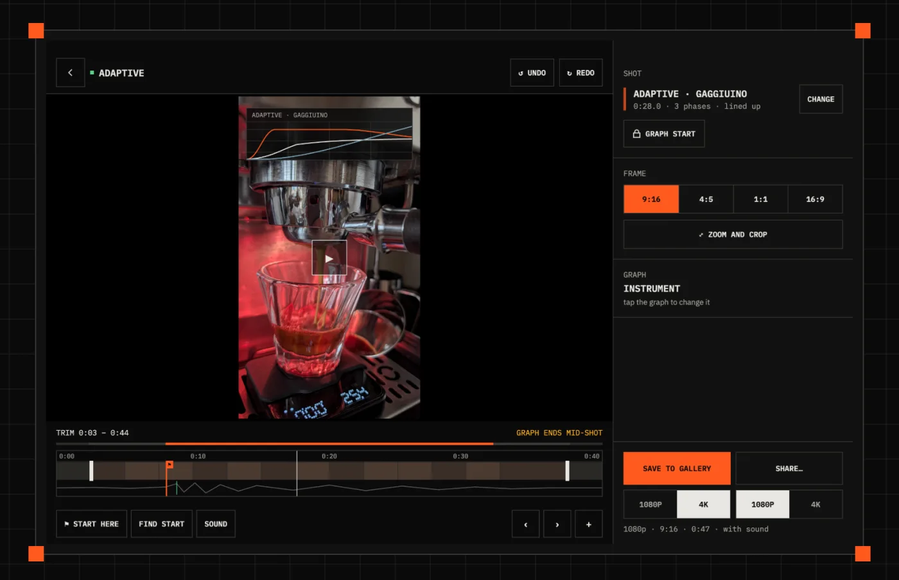
</p>

### Export

- Save to your gallery in up to 4K, or share at 1080p to Instagram, WhatsApp, Messages and anywhere else.
- Keep the sound, or mute it.

<p align="center">
  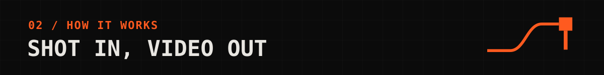
</p>

<p align="center">
  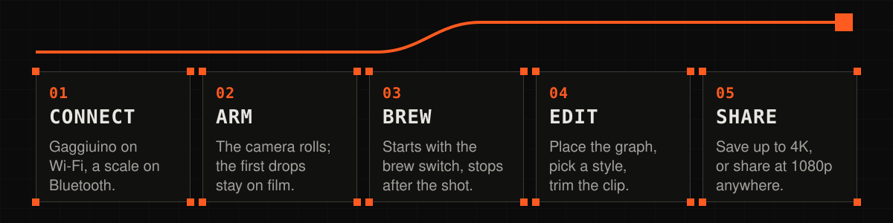
</p>

| | |
| --- | --- |
| **Everywhere you are** | Record on Android and iOS phones, tablets and foldables, in portrait, landscape and tabletop. Edit on the same devices, on the desktop, or [in the browser](https://onlyshots.vercel.app). |
| **Export matches preview** | One scene drives the camera view, the editor and every exporter, so the video comes out exactly as you placed it. |
| **Private by design** | No account, no ads, no analytics, no tracking. Videos, shots and settings stay on your device; OnlyShots talks only to the machine and scale you pick. |
| **Open** | Built with Compose Multiplatform. Every protocol is read from its public source, and a new machine follows the Gaggiuino template ([below](#add-a-new-machine)). |

<p align="center">
  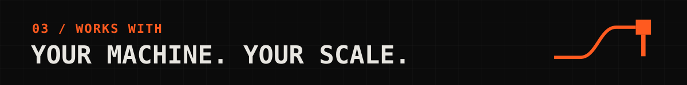
</p>

## Machines and scales

Pressure, flow and temperature come from machines with a network API; weight comes from a Bluetooth scale. Home
finds both by itself; pick one and record.

- **Machines:** Gaggiuino (the public release and newer firmware) and GaggiMate. A GaggiMate Standard has no pressure
  sensor, so it draws flow and temperature; a Pro draws pressure too.
- **Scales:** Acaia, Bookoo, Decent Scale, DiFluid, Eclair, EspressiScale, Felicita, iKape, Insmart, MyScale, Precisa,
  Tencent, Timemore, Varia, WeighMyBru and Wilfa.

<p align="center">
  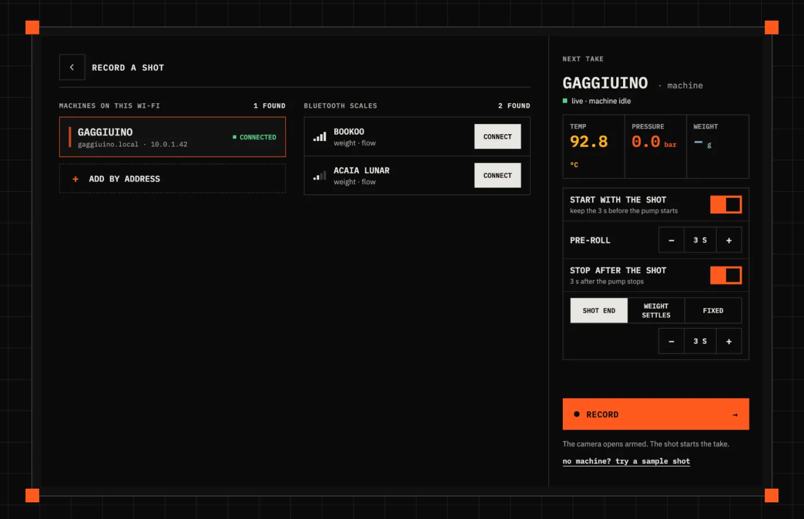
</p>

Machine missing? [Add it](#add-a-new-machine), or [ask for it](https://github.com/parez-dev/OnlyShots/issues).

### The details

Each format from public source. Pinned to commit read (see decoder doc comment).

| Source | Live data | Shot start / end | History |
| --- | --- | --- | --- |
| Gaggiuino (`release/stm32-blackpill`) | `ws://host/ws` JSON, ~10 Hz brewing | `receivedAt − timeInShot`; last `timeInShot` | none |
| Gaggiuino, newer (core `6ea560e`) | `ws://host/ws` binary protobuf, `d_sensor_snap` ~3 Hz | first/last snapshot with `brewActive` | HTTP: `GET /api/shots/latest`, then `/api/shots/{id}` down (`GaggiuinoHistory`) |
| GaggiMate (master `b78beee`) | `ws://host/ws` JSON `evt:status`, 2 Hz, partial frames merged | `process.a` 1 then 0; time from `process.e` | HTTP: `GET /api/history/recent.bin`, then `<id>.slog` (`GaggiMateHistory`) |
| Scale only | Bluetooth | first drops (> 0.3 g after tare); stop rule ends | recordings made in app |

- **Finding:** `NetworkScan` = mDNS (`_http._tcp`, Android), sweep of own /24, fixed `.local` names last. Each
  candidate confirmed with `identify`. Probe closes fast: ESP32 takes ~3 clients. **add by address** for networks
  scan can't see.
- **Old kinds:** `SourceKind.DECENT` stays. Old sidecars name it. Saved ones start disconnected.
- **Scales:** ported from MIT `Zer0-bit/esp-arduino-ble-scales` (ee17c40) and Bookoo's protocols. Acaia, Bookoo,
  Decent Scale, EspressiScale, DiFluid, Eclair, Felicita, iKape, Insmart, MyScale, Precisa, Tencent, Timemore, Varia,
  WeighMyBru, Wilfa. Zer0-bit ones tested only against upstream byte layouts. One connection at a time: scale's own
  app can't connect while OnlyShots holds it.
- **Why network for machines:** pressure, flow, temp only from machine API. App reads beside machine's own app.
  Bluetooth only for scales.

<p align="center">
  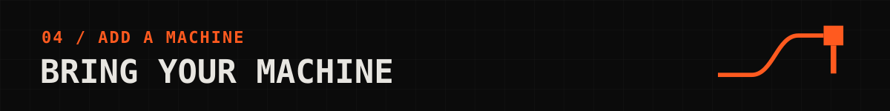
</p>

## Add a new machine

Gaggiuino is template. New machine = one `NetworkMachine`, a decoder, a `SourceKind`, tests. PR welcome.

**1. Read machine's API.** WebSocket or HTTP on local network. Use public source. Pin it: decoder's doc comment
names upstream repo, file, branch, commit (see `GaggiuinoDecoder`). Reference only. No copied code from
incompatible licenses.

**2. Add kind.** New value in `SourceKind` (`core/model/.../Source.kt`). Never rename or remove values: sidecars
store them by name. Compiler then flags every `when` to fill:

- `Capabilities.of` (`Source.kt`): series, phases, history, trigger.
- `machineName` (`core/model/.../Names.kt`): the machine's name.
- `machineColor` (`core/ui/.../edit/MachineColor.kt`) + new `CgColors.Machine.*` colour.
- `RecordSession.triggerText` (`feature/record/`) + new `record_trigger_*` string.

**3. Write source** in `sources/src/commonMain/kotlin/app/onlyshots/sources/machine/`:

- **Decoder:** `MachineDecoder`. `decodeText` / `decodeBinary` turn frames into `MachineMessage.Reading` (a sample)
  or `MachineMessage.Brew` (start/end). `reset` clears state.
- **Machine:** object implementing `NetworkMachine`:
  - `kind`, `name`, `defaultPort`, `hostnames` (fixed `.local` names).
  - `autoStart`: what starts recording. `AutoStart.BREW_SWITCH` or `PROCESS_START` today. New way? New value +
    wording in `autoStartHint` (`feature/home/.../HomeState.kt`).
  - `matchesService`: cheap mDNS filter. `identify` decides.
  - `identify`: fast probe. Close connection right away.
  - `source(...)`: return unstarted `WebSocketShotSource` with your decoder.
  - `history(...)` (optional): `MachineHistory` with `list` / `load` for recent shots. Powers "from the machine"
    picker. Default `MachineHistory.None`.
- **Register:** append to `NetworkMachines.all`. Scan, Home, saved source, machine log pick it up. Append, not
  prepend: `all.first()` is default machine.

**4. Optional:**

- **Shot files:** parser beside `GaggiuinoShotFile` (`core/model`), routed by shape in `ShotFiles.parse`, which
  every import goes through. A binary format is told apart by its first bytes instead (`GaggiMateShotLog`). This is
  the only part of a machine the web editor can use: it cannot reach a machine on the network at all. A machine whose
  shots reach Visualizer needs nothing: its normalized form is read already.
- **Own look:** built-in style in `GraphStyles.matching(source)`. Else Metro.
- **Style editor:** add machine to the source list in `StyleSaveSheet.kt`.
- **Words:** user text goes in `core/resources/.../values/strings_<area>.xml`. Machine name stays code.

**5. Tests.** Mirror Gaggiuino's:

- `GaggiuinoDecoderTest`, `GaggiuinoBinaryTest`: real frame shapes in, samples out.
- `NetworkScanTest`: its `FakeMachine` shows contract.
- `GaggiuinoIdentifyTest`, `GaggiuinoWebSocketTest`, `GaggiuinoHistoryTest` (androidHostTest): fake machine on
  Ktor `embeddedServer(CIO, port = 0)`. Start server outside `runBlocking`, or test hangs.
- `GaggiuinoShotFileTest` if you add file parser.
- UI changed? `./gradlew :screenshots:recordMugshot`, look at diff, commit goldens.

**6. Docs.** Add row to machines table above.

**7. Open PR.**

```
# fork github.com/parez-dev/OnlyShots, then:
git checkout -b machine/your-machine
./gradlew ktfmtFormat
./gradlew ktfmtCheck testAndroidHostTest :screenshots:verifyMugshot
git push -u origin machine/your-machine     # open PR on GitHub
```

Say in PR:

- Machine, firmware version, upstream commit pinned.
- How tested: real machine on phone, or captured frames.
- Sample frames or a `.shot` file if you can. Helps review.

PR checks (`.github/workflows/pr.yml`): format, version check, unit tests, screenshots. Branch PRs run on our
self-hosted Mac. Fork PRs run on GitHub's runner, so stranger code never touch our machine. After merge, `ci.yml`
on `main` runs full build: every platform, export tests, web deploy.

## Build it yourself

No setup, no secrets. Clone and build:

```
./gradlew :app:androidApp:assembleDebug                      # Android app
./gradlew :app:desktopApp:run                                # desktop editor
./gradlew :app:webApp:wasmJsBrowserDevelopmentRun            # web editor, http://localhost:8080
cd app/iosApp && xcodegen generate                           # iOS: then build scheme iosApp in Xcode
```

No machine at hand? Home's **try a sample shot** replays a real shot, in any build.

Modules, tests, the build, releases, and the desktop and web editors: **[developer guide](docs/DEVELOPMENT.md)**.

---

OnlyShots is an independent app, not affiliated with Gaggia, Gaggiuino or any scale maker. Names are used only to say
what the app works with. Questions or ideas: [open an issue](https://github.com/parez-dev/OnlyShots/issues).

Open Sans: SIL Open Font License 1.1 (`core/resources/OPEN_SANS_LICENSE.txt`). IBM Plex Mono and Plex Sans: SIL Open
Font License 1.1 (`core/resources/IBM_PLEX_LICENSE.txt`).
Icons: OnlyShots' own (`design/icons/`, rules in `GUIDELINES.md`), written as vector drawables by
`design/icons/build.py`.
